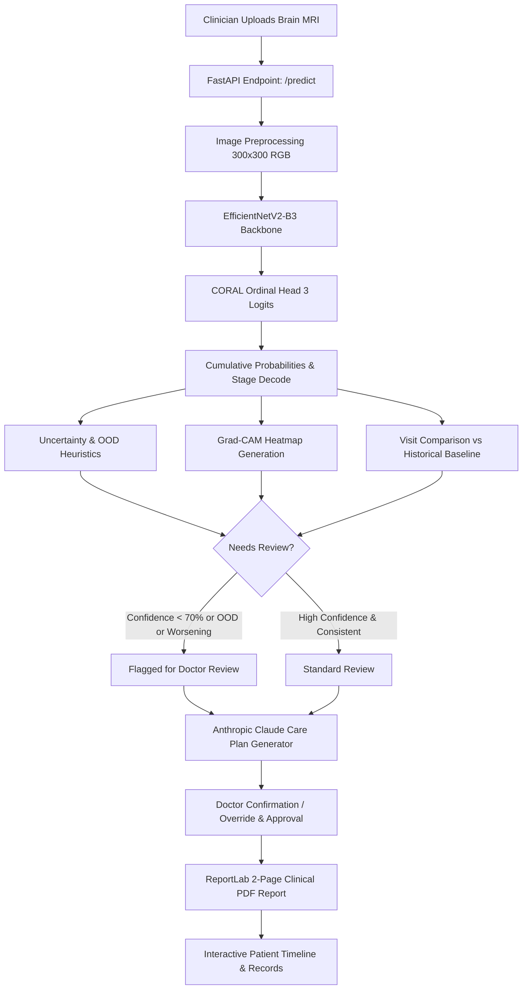
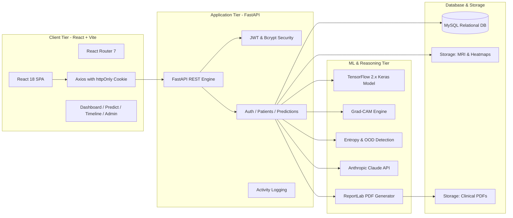

# NeuroCare_AI
AI-assisted early Alzheimer's disease detection and clinical decision support system

## 📌 Overview

Alzheimer's disease is a progressive neurodegenerative disorder that accounts for 60–80% of all dementia cases worldwide. Early detection during the pre-symptomatic or very mild stages is crucial to slowing cognitive decline and maximizing quality of life.

**NeuroCare AI** is an end-to-end, hospital-ready clinical decision support platform designed to assist neurologists, radiologists, and clinicians. Rather than providing isolated black-box classifications, NeuroCare AI integrates:

1. **Deep Learning MRI Staging**: EfficientNetV2-B3 with CORAL (Consistent Rank Logits) ordinal loss.
2. **Visual Explainability**: Grad-CAM heatmaps highlighting hippocampal and cortical volume loss.
3. **Safety & Uncertainty Quantification**: Normalized Shannon entropy scoring and out-of-distribution (OOD) screening.
4. **Physician-in-the-Loop Governance**: Strict confirmation and override mechanisms with mandatory clinical notes.
5. **Longitudinal Patient Journey**: Historical timeline tracking scans, cognitive scores (MMSE, MoCA), and disease trajectories across visits.
6. **AI Personalized Care Plans**: Anthropic Claude-powered individualized precautions and follow-up regimens with validated clinical fallbacks.
7. **Institutional 2-Page PDF Reports**: Radiology-grade reports embedding side-by-side scans, multi-modal lab evaluations, and physician signatures.

---

## 🚀 Key Features

### 1. 🔬 Deep Learning MRI Staging (CORAL Ordinal Regression)
- **Backbone Architecture**: EfficientNetV2-B3 convolutional neural network optimized for $300 \times 300$ high-resolution brain MRI slices with internal normalization.
- **Ordinal Severity Modeling**: Employs Consistent Rank Logits (CORAL) to classify across 4 clinically ranked stages:
  - `NonDemented` (Normal / Cognitively Unimpaired)
  - `VeryMildDemented` (Very Mild Cognitive Changes / MCI)
  - `MildDemented` (Mild Alzheimer's Disease)
  - `ModerateDemented` (Moderate Alzheimer's Disease)
- Unlike traditional categorical cross-entropy models that penalize all classification errors equally, the CORAL formulation penalizes distance along the clinical continuum, drastically reducing catastrophic stage-jump errors.

### 2. 👁️ Explainable AI with Grad-CAM
- Gradient-weighted Class Activation Mapping (Grad-CAM) tailored to nested backbone models and ordinal output heads.
- Pinpoints anatomical regions guiding the prediction:
  - Hippocampal atrophy and medial temporal lobe shrinkage
  - Ventricular enlargement (ex-vacuo hydrocephalus)
  - Cortical thinning across temporoparietal memory centers
- Overlays jet color heatmaps directly onto the original MRI for instantaneous radiologist verification.

### 3. 🛡️ Uncertainty Quantification & OOD Screening
- **Entropy-Based Uncertainty**: Computes normalized Shannon entropy $H \in [0, 1]$ across class probabilities. High entropy signals ambiguous or borderline scans between adjacent stages.
- **Out-of-Distribution (OOD) Heuristics**: Automatically flags inputs when probability peaks are unusually low and entropy is high, catching non-brain MRI images, inverted scans, or severe scan artifacts.
- **Automatic Review Routing**: Automatically flags scans for manual doctor review if:
  - Model confidence falls below the clinical threshold (default: $< 70\%$)
  - OOD heuristic is triggered
  - The patient demonstrates an accelerated worsening trend vs. their prior visit

### 4. 👨‍⚕️ Physician Review & Clinical Governance
- NeuroCare AI strictly implements **human-in-the-loop** decision support:
  - Attending physicians can **Confirm** the AI finding or **Override** it with an alternative diagnosis.
  - Mandatory doctor rationale and clinical notes are logged to the permanent record.
  - Review status and attending doctor attribution are stamped into the final signed PDF report.

### 5. 📈 Longitudinal Patient Timeline & Trajectory
- Centralized patient dashboard with a multi-visit chronological journey:
  - Compare MRI scans and Grad-CAM overlays across months/years side-by-side.
  - Track cognitive assessment trajectories (Mini-Mental State Exam **MMSE** & Montreal Cognitive Assessment **MoCA** on $0\text{--}30$ scales).
  - Automated risk trend evaluation: `Stable`, `Worsening`, or `Improving`.
  - Next visit scheduling and follow-up alert tracking.

### 6. 🤖 Claude-Powered Personalized Care Plans
- Individualized clinical care plans generated by **Claude Sonnet** via the Anthropic API.
- Synthesizes patient-specific multi-modal parameters:
  - Age, gender, and current staging
  - Cognitive assessment scores (MMSE/MoCA)
  - Medical history, medications, and family history
  - Lifestyle factors (smoking, physical activity, sleep quality)
- **Clinical Safety Fallback**: If the API key is not configured or network access fails, the system automatically falls back to curated static clinical guidelines without interrupting workflow.
- **Doctor Approval Gate**: Care plans require physician sign-off before being marked active and are flagged as *stale* if patient clinical data is edited.

### 7. 📄 2-Page Institutional Radiology PDF Report
- Generates a 2-page clinical report via ReportLab:
  - **Page 1**: Patient demographics, side-by-side original MRI scan and Grad-CAM heatmap, anatomical correlates, CT brain notes, and medical/lifestyle history.
  - **Page 2**: Metabolic blood panel, physical examination, neurological assessment, cognitive testing & cerebellar coordination, specialized biomarkers (CSF & Amyloid PET), personalized care plan, and doctor signature block.

### 8. 🔐 Enterprise Security & Role-Based Access Control (RBAC)
- Two distinct user tiers:
  - **Admin**: System-wide statistics, user management (create/delete doctor accounts), and full audit log inspection.
  - **Doctor**: Manages assigned patients, uploads MRI scans, conducts reviews, and generates reports.
- **Security Best Practices**:
  - `httpOnly` secure cookies for JWT authentication (resistant to XSS token theft).
  - Strong password hashing via `passlib[bcrypt]`.
  - Comprehensive audit trail recording user actions, timestamps, patient IDs, and client IP addresses.

---

## 🏗️ System Architecture

### 🔄 End-to-End Clinical Workflow



### 🏛️ Component Architecture



---

## 💻 Technology Stack

| Domain | Technology | Description |
| :--- | :--- | :--- |
| **Backend Framework** | **FastAPI** (`0.115.0`) | High-performance asynchronous REST API with automatic OpenAPI documentation. |
| **Server Engine** | **Uvicorn** (`0.30.6`) | Lightning-fast ASGI web server implementation. |
| **Deep Learning** | **TensorFlow / Keras** (`2.21.0`) | EfficientNetV2-B3 backbone with custom CORAL ordinal regression head. |
| **Computer Vision** | **OpenCV** (`4.10.0`) & **Pillow** (`11.0.0`) | Image processing, resizing, color mapping, and heatmap blending. |
| **Generative AI** | **Anthropic Claude SDK** (`0.40.0`) | Personalized clinical care plans grounded in clinical guidelines. |
| **PDF Generation** | **ReportLab** (`4.2.5`) | High-precision, 2-page vector clinical PDF reports. |
| **Database** | **MySQL** (`8.0+`) & `mysql-connector-python` | Relational storage for users, patients, scans, predictions, and audit logs. |
| **Authentication** | **python-jose** & **passlib[bcrypt]** | JWT bearer tokens in `httpOnly` cookies with salted bcrypt password hashing. |
| **Frontend Framework** | **React** (`18.3.1`) & **Vite** (`7.3.6`) | Modern, component-driven reactive single-page application. |
| **Routing & Client** | **React Router** (`7.18.3`) & **Axios** (`1.7.7`) | Client-side routing with authenticated HTTP communications. |

---

## 📂 Project Directory Structure

```text
NeuroCare_AI/
├── README.md                           # Main repository documentation
└── Project/
    ├── .gitignore                      # Git ignore rules
    ├── backend/
    │   ├── .env                        # Environment configuration (secrets, DB credentials)
    │   ├── requirements.txt            # Python dependencies
    │   ├── create_user.py              # Bootstrap script for initializing the admin user
    │   ├── app/
    │   │   ├── __init__.py
    │   │   ├── main.py                 # FastAPI application entry point & CORS configuration
    │   │   ├── config.py               # Central environment and application settings
    │   │   ├── auth.py                 # JWT token generation, verification & bcrypt hashing
    │   │   ├── database.py             # MySQL connection pool, migrations & query routines
    │   │   ├── schemas.py              # Pydantic request/response data contracts
    │   │   ├── care_plans.py           # Validated stage-specific static clinical guidelines
    │   │   ├── ai_care_plan.py         # Claude-powered clinical care plan generator
    │   │   ├── routers/
    │   │   │   ├── auth_routes.py      # Login, registration, user management, audit logs
    │   │   │   ├── patients.py         # Patient CRUD, cognitive history, clinical updates
    │   │   │   └── predictions.py      # MRI upload, inference, Grad-CAM, reviews & reports
    │   │   ├── ml/
    │   │   │   ├── coral_loss.py       # CORAL ordinal cross-entropy loss function
    │   │   │   ├── coral_utils.py      # CORAL logits decode and stage probability mapping
    │   │   │   ├── predict.py          # Model loader, image preprocessing and inference
    │   │   │   ├── gradcam.py          # Explainability engine for EfficientNetV2-B3
    │   │   │   ├── uncertainty.py      # Shannon entropy uncertainty and OOD heuristics
    │   │   │   └── pdf_report.py       # 2-Page institutional radiology PDF generator
    │   │   └── data/
    │   │       ├── saved_models/       # Trained model weights (e.g. best_model.keras)
    │   │       ├── uploads/            # Uploaded MRI scans and generated Grad-CAM overlays
    │   │       └── reports/            # Generated 2-page clinical PDF reports
    └── frontend/
        ├── index.html                  # HTML entry point
        ├── vite.config.js              # Vite configuration
        ├── package.json                # Frontend package dependencies and scripts
        └── src/
            ├── main.jsx                # React root mount
            ├── App.jsx                 # Route definitions & layout structure
            ├── index.css               # Design system, variables, utilities & dark theme
            ├── api/
            │   └── client.js           # Axios HTTP client with credentials
            ├── components/
            │   ├── Layout.jsx          # App shell with header and sidebar navigation
            │   ├── Header.jsx          # User profile status and logout trigger
            │   ├── Sidebar.jsx         # Clinical navigation bar
            │   ├── AdminRoute.jsx      # Route guard restricting access to admins
            │   ├── CarePlanPanel.jsx   # Interactive care plan editor and approval card
            │   └── ReviewActions.jsx   # Doctor review, confirm and override modal
            └── pages/
                ├── Login.jsx           # Doctor/Admin login and self-registration
                ├── Dashboard.jsx       # Clinical metrics, stage distribution & alert feed
                ├── Predict.jsx         # MRI upload, inference and Grad-CAM visualization
                ├── Patients.jsx        # Patient directory, intake form & follow-up scheduler
                ├── PatientTimeline.jsx # Longitudinal history, multi-visit scans & cognitive scores
                ├── CarePlans.jsx       # Centralized care plan governance & approvals
                ├── Followups.jsx       # Schedule of upcoming patient consultations
                ├── History.jsx         # Global scan audit log and historical predictions
                ├── Reports.jsx         # Quick-access radiology PDF report repository
                ├── Settings.jsx        # User profile, clinic affiliation and preferences
                └── Admin.jsx           # User provisioning and system audit logs
```

---

## ⚙️ Installation & Setup

### 📋 Prerequisites
Before starting, ensure you have the following installed on your system:
- **Python 3.10+**
- **Node.js 18+** & **npm**
- **MySQL Server 8.0+**
- *(Optional)* An **Anthropic API Key** for personalized Claude care plans (the app operates smoothly using static clinical plans if omitted).

---

### Step 1: Clone the Repository

```bash
git clone https://github.com/KhotShraddha27/NeuroCare_AI.git
cd NeuroCare_AI/Project
```

---

### Step 2: Database Setup

Ensure your MySQL server is running. Create a dedicated database or allow NeuroCare AI to initialize it automatically on first startup.

```sql
CREATE DATABASE IF NOT EXISTS neurocare;
```

---

### Step 3: Backend Setup

1. **Navigate to the backend directory**:
   ```bash
   cd backend
   ```

2. **Create and activate a Python virtual environment**:
   ```bash
   # Windows (PowerShell)
   python -m venv venv
   .\venv\Scripts\activate

   # Linux / macOS
   python3 -m venv venv
   source venv/bin/activate
   ```

3. **Install required dependencies**:
   ```bash
   pip install -r requirements.txt
   ```

4. **Configure Environment Variables**:
   Create or edit the `.env` file in the `Project/backend/` directory:
   ```env
   # Database Credentials
   DB_HOST=localhost
   DB_PORT=3306
   DB_USER=root
   DB_PASSWORD=your_mysql_password
   DB_NAME=neurocare

   # Security & Session
   NEUROCARE_SECRET_KEY=generate_a_secure_random_key_here
   NEUROCARE_REVIEW_THRESHOLD=70

   # AI Care Plans (Optional - Leave blank for automatic clinical fallback)
   ANTHROPIC_API_KEY=your_anthropic_api_key
   AI_CARE_PLAN_MODEL=claude-sonnet-5
   ```

5. **Verify Model Weights**:
   Ensure `best_model.keras` is placed in `Project/backend/app/data/saved_models/best_model.keras`.

6. **Bootstrap the Administrator Account**:
   Run the setup script to create your first admin account:
   ```bash
   python create_user.py admin admin123 "System Administrator" admin
   ```
   *(You can also create doctor accounts directly via this script or through the Admin web portal once logged in).*

7. **Start the FastAPI Backend Server**:
   ```bash
   uvicorn app.main:app --reload --host 0.0.0.0 --port 8000
   ```
   The backend API will start at `http://localhost:8000`. You can inspect the Swagger documentation at `http://localhost:8000/docs`.

---

### Step 4: Frontend Setup

1. **Open a new terminal window** and navigate to the frontend directory:
   ```bash
   cd NeuroCare_AI/Project/frontend
   ```

2. **Install frontend dependencies**:
   ```bash
   npm install
   ```

3. **Start the Vite development server**:
   ```bash
   npm run dev
   ```

4. **Access the Web Application**:
   Open your browser and navigate to:
   ```text
   http://localhost:5173
   ```
   Sign in using the administrator credentials created in Step 3 (`admin` / `admin123`) or register a new doctor account on the login page.

---

## 🔧 Configuration

The backend application behavior can be customized using environment variables in `Project/backend/.env`:

| Variable | Default Value | Description |
| :--- | :--- | :--- |
| `DB_HOST` / `NEUROCARE_DB_HOST` | `localhost` | MySQL database host address. |
| `DB_PORT` / `NEUROCARE_DB_PORT` | `3306` | MySQL database port. |
| `DB_USER` / `NEUROCARE_DB_USER` | `root` | MySQL database username. |
| `DB_PASSWORD` / `NEUROCARE_DB_PASSWORD` | `root` | MySQL database password. |
| `DB_NAME` / `NEUROCARE_DB_NAME` | `neurocare` | Target database name. |
| `NEUROCARE_SECRET_KEY` | `change-this-before-deploying` | Secret key used for signing JWT tokens. |
| `NEUROCARE_REVIEW_THRESHOLD` | `70` | Confidence percentage threshold below which scans require mandatory doctor review. |
| `ANTHROPIC_API_KEY` | *(None)* | Anthropic API key for personalized Claude care plans. |
| `AI_CARE_PLAN_MODEL` | `claude-sonnet-5` | Claude model variant used for synthesizing patient care plans. |

---

## 📡 API Endpoints

FastAPI exposes an interactive OpenAPI specification available at `http://localhost:8000/docs`. Key routes include:

### 🔐 Authentication (`/auth`)
- `POST /auth/register` — Register a new doctor account.
- `POST /auth/login` — Authenticate and receive an `httpOnly` session cookie.
- `POST /auth/logout` — Invalidate the user session.
- `GET  /auth/me` — Retrieve the current authenticated user's profile.
- `POST /auth/admin/create-user` — *(Admin only)* Provision a new clinician or administrator.
- `GET  /auth/admin/users` — *(Admin only)* List all registered users.
- `GET  /auth/admin/activity-logs` — *(Admin only)* Review system-wide audit activity logs.

### 👤 Patients (`/patients`)
- `POST /patients/` — Register a new patient (demographics, clinical & lifestyle history).
- `GET  /patients/` — Retrieve the list of patients under the doctor's care.
- `GET  /patients/{patient_id}` — Get comprehensive clinical details for a specific patient.
- `PUT  /patients/{patient_id}` — Update cognitive scores (MMSE, MoCA) and clinical notes.
- `DELETE /patients/{patient_id}` — Remove a patient record and associated scan data.
- `GET  /patients/{patient_id}/timeline` — Retrieve the full longitudinal visit history and scan progression.
- `GET  /patients/overview/status-by-stage` — Aggregate patient breakdown across the 4 Alzheimer's stages.
- `GET  /patients/overview/care-plans` — Overview of all active and pending patient care plans.

### 🧠 Predictions & Clinical Decision Support (`/predictions`)
- `POST /predict/{patient_id}` — Upload an MRI scan (`JPG`/`PNG`), execute CORAL model inference, compute Grad-CAM, uncertainty score, and generate the care plan and 2-page PDF.
- `GET  /predictions/history` — Global list of scan predictions.
- `PATCH /predictions/{prediction_id}/review` — Doctor confirmation or override of the AI staging with clinical notes.
- `POST /predictions/{prediction_id}/care-plan/approve` — Clinician sign-off on the generated care plan.
- `POST /predictions/{prediction_id}/care-plan/regenerate` — Re-synthesize care plan after patient clinical updates.
- `GET  /predictions/report/{filename}` — Download the finalized 2-page clinical PDF report.
- `GET  /predictions/image/{filename}` — Retrieve MRI scans or Grad-CAM overlay assets.
- `GET  /dashboard/stats` — High-level clinic stats (total patients, pending reviews, active alerts).

---

## 📊 Cognitive & Clinical Staging Reference

NeuroCare AI references standard clinical severity gradations correlated with cognitive scores:

| Stage Label | Clinical Description | Typical MMSE ($0\text{--}30$) | Typical MoCA ($0\text{--}30$) | Structural MRI Correlates |
| :--- | :--- | :---: | :---: | :--- |
| **NonDemented** | Normal cognitive function | $27\text{--}30$ | $26\text{--}30$ | Intact hippocampal and cortical volume; normal ventricles for age. |
| **VeryMildDemented** | Very mild cognitive changes (MCI) | $24\text{--}26$ | $22\text{--}25$ | Early micro-structural volume loss in medial temporal lobes; subtle hippocampal shrinkage. |
| **MildDemented** | Mild Alzheimer's disease | $18\text{--}23$ | $15\text{--}21$ | Bilateral hippocampal atrophy; compensatory ventricular dilation; temporoparietal thinning. |
| **ModerateDemented** | Moderate Alzheimer's disease | $10\text{--}17$ | $8\text{--}14$ | Generalized cortical atrophy; severe bilateral hippocampal reduction; pronounced ventriculomegaly. |

---

## ⚕️ Clinical Disclaimer

> **RESEARCH & DECISION SUPPORT DISCLAIMER**:
> NeuroCare AI is designed strictly as a **Clinical Decision Support System (CDSS)** to augment the diagnostic workflow of licensed healthcare professionals. It is **NOT** an autonomous diagnostic device, nor a substitute for professional medical judgment, laboratory testing, comprehensive neurological examination, or radiologist review. All AI predictions, visual heatmaps, uncertainty flags, and care recommendations must be independently evaluated and approved by a qualified physician before initiating any patient care or intervention.

---

## 👥 Contributors & Acknowledgements

- **Development Team**: NeuroCare AI Project Contributors
- **Backbone Model Reference**: EfficientNetV2 Architecture & CORAL Ordinal Regression Framework.
- **Explainability**: Gradient-weighted Class Activation Mapping (Grad-CAM) algorithm.
- **Language Intelligence**: Powered by Anthropic Claude for clinical care plan contextualization.

---

## 📄 License

This project is licensed under the **MIT License** — see the [LICENSE](LICENSE) file for full details.

